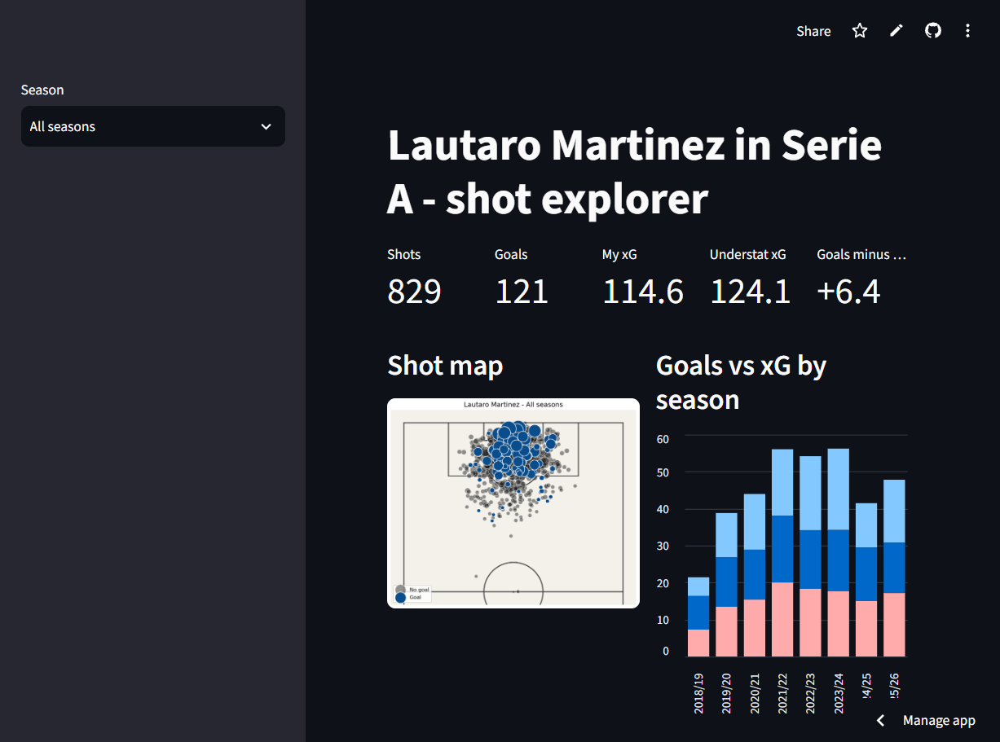
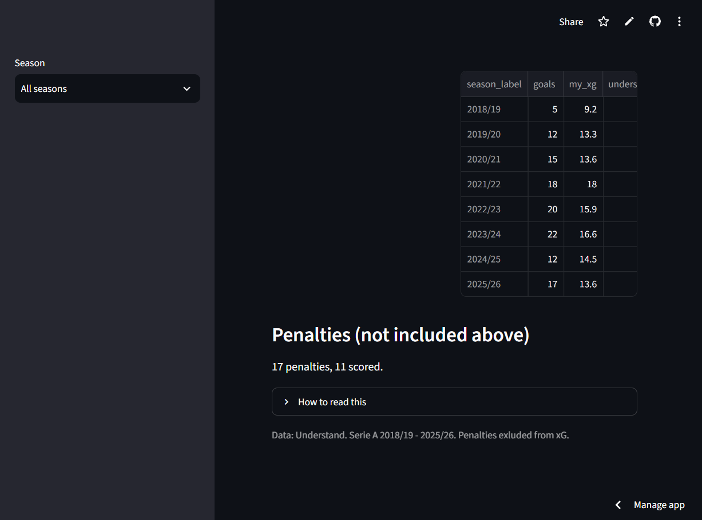
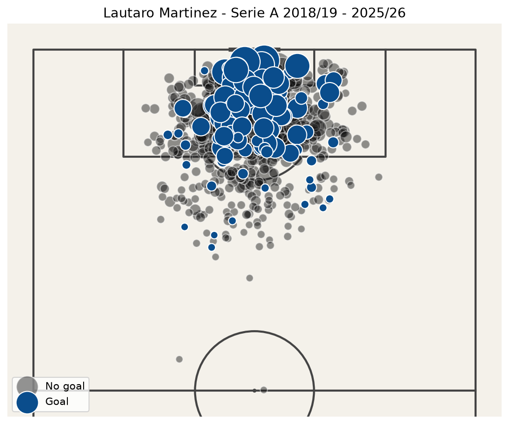
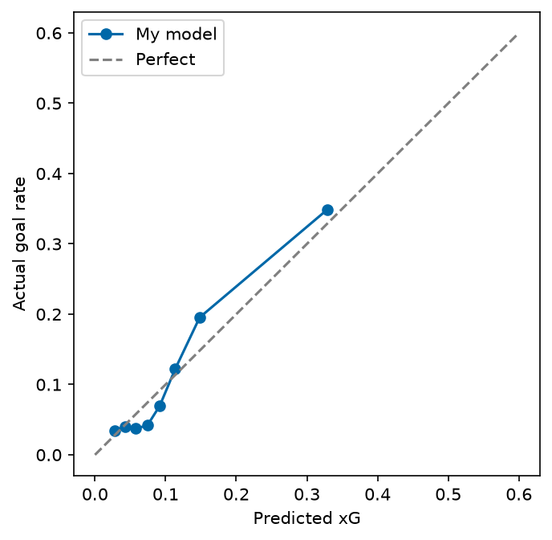

# Lautaro Martínez in Serie A shot map and xG model

Shot map, expected goals (xG) model and Streamlit dash board for Lautaro Martínez, built with Python on Serie A data from 2018/19 to 2025/26 (his years Inter, excluding the current season, 2026/27).

**Live app:** https://lautaro-xg.streamlit.app/






## The question

Does Lautaro score more or fewer goals than an average striker would with the same chances?

## How it works

1. **Data**: shots from [Understat](https://understat.com) (position, result, situation, body part, xG) for Lautaro and for the top shooters of each Serie A season (190 players).
2. **Features**: distance of the goal, angle of the goal, header, open play. Penalties are analysed separately.
3. **Model**: logistic regression trained on the shots of **other players only**. If it were trained on Lautaro's own shots, "goals minus xG" would be close to zero by construction.
4. **Evaluation**: AUC, log loss and Brier score compared with Understat's xG, plus a calibration plot.
5. **Dashboard**: Streamlit app with a season selector, shot map, goals vs xG chart and penalties.

## Results (no penalties)

| Season  | Shots | Goals | My xG | Understat xG |
|---------|------:|------:|------:|-------------:|
| 2018/19 | 64    | 5     | 9.2   | 7.3          |
| 2019/20 | 122   | 12    | 13.3  | 13.4         |
| 2020/21 | 107   | 15    | 13.6  | 15.4         |
| 2021/22 | 112   | 18    | 18.0  | 20.0         |
| 2022/23 | 124   | 20    | 15.9  | 18.3         |
| 2023/24 | 106   | 22    | 16.6  | 17.6         |
| 2024/25 | 102   | 12    | 14.5  | 15.0         |
| 2025/26 | 92    | 17    | 13.6  | 17.1         |
| **Total** | **829** | **121** | **114.6** | **124.1** |

- Penalties: 17 taken, 11 scored.
- Correlation between my xG and Understat xG: 0.745.
- Model quality: AUC = 0.767 (Understat: 0.795).



**Reading the results:** over eight seasons Lautaro scores roughly what the chances suggest. My model says about 6 goals more than expected, while Understat's xG says about 3 fewer. The two models disagree, so the honest conclusion is "close to expectation", nor "great" nor "poor" finisher. A single season (about 100 shots) is too small to say much: differences of ±5 goals is indifferent.

## Limitations 

- Small sample per season; goals minus xG changes a lot, the total of eight seasons is more reliable.
- The model only knows the distance, angle, header and open play. It does not know about defenders, the goalkeeper or the pass before the shot, so it is less precise than Understat's.
- League matches only: no cup, Champions League or national team games.
- Understat's coordinates are normalised (0 to 1) and converted to metres assumiong a 105 x 68 pitch.

## How to run

```bash
git clone https://github.com/sajrasadikovic/project-xG.git
cd project-xG
python -m venv .venv
.venv\Scripts\Activate.ps1        # Windows PowerShell
pip install -r requirements.txt

python -m src.data                # Lautaro's shots
python -m src.data_league         # shots of other players (takes a few minutes)
python -m src.model               # train and evaluate the model
streamlit run app.py              # dashboard
```

## Project structure 

```
app.py               Streamlit dashboard
src/data.py          download Lautaro's shots from Understat
src/data_league.py   download shots of other Serie A players
src/features.py      distance, angle and other features
src/model.py         xG model and evaluation
src/plots.py         shot maps
assets/              images used in this README
```

## Data

Data comes from [Understat](https://understat.com) trough the unofficial `understatapi` package. The data files are not included in this repository: the scripts need to be run to download them. All credit for the data goes to Understat.


